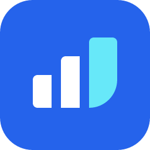
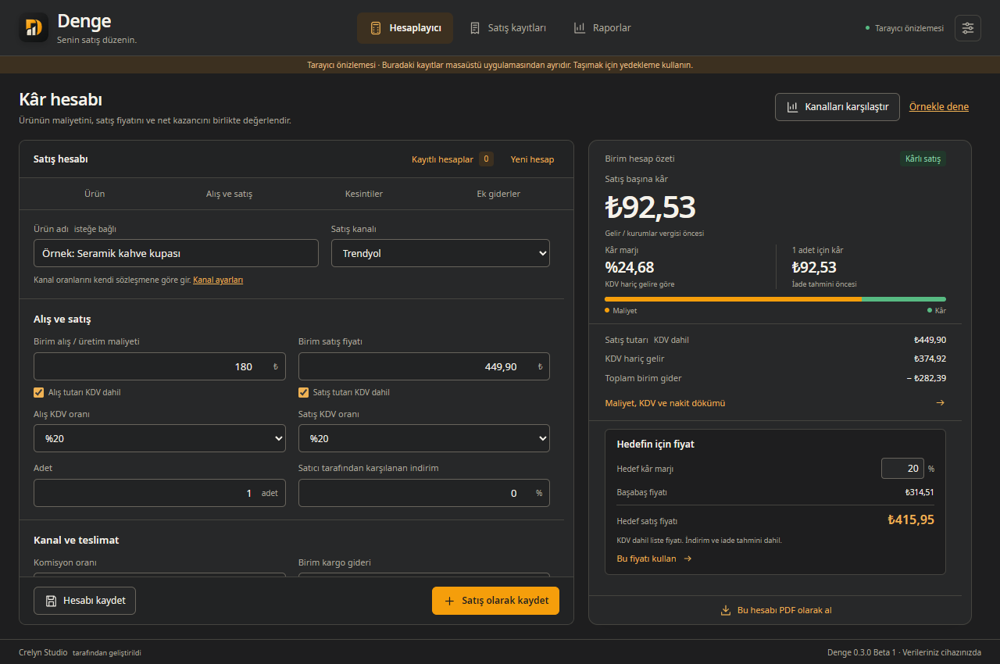
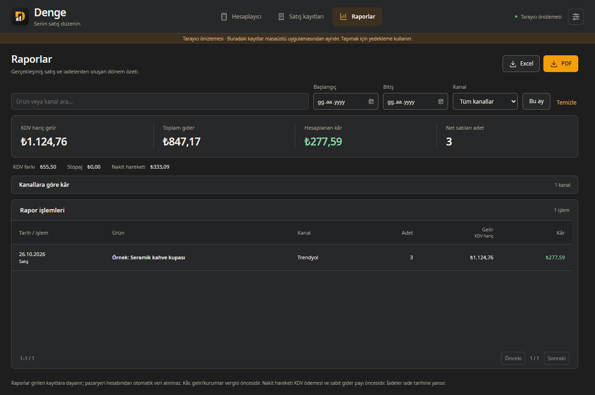
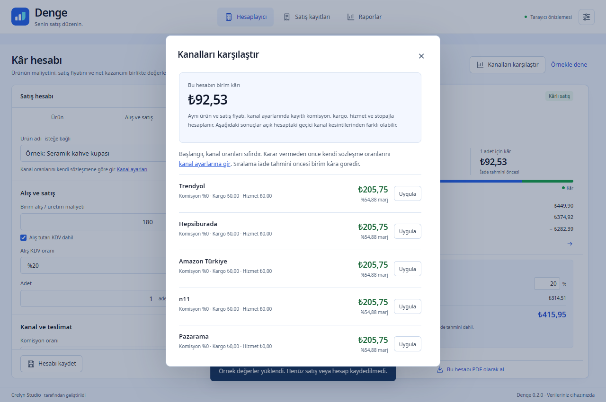

# Denge — E-ticaret Kâr Hesaplayıcı

**Satmadan önce kârını gör.** Komisyon, kargo ve KDV sonrası kazancını hesapla; satışlarını takip et, Excel ve PDF raporları oluştur.

[**Windows 11 x64 için indir — ücretsiz, 0.2.0 Beta 1**](https://github.com/crelynstudio/denge-eticaret-kar-hesaplayici/releases/download/v0.2.0-beta.1/Denge-0.2.0-beta.1-Windows11-x64.zip) · [Sürüm notları ve SHA-256](https://github.com/crelynstudio/denge-eticaret-kar-hesaplayici/releases/tag/v0.2.0-beta.1)

**Senin satış düzenin.** Türkiye'deki bireysel satıcılar ve işletmeler için tamamen Türkçe, çevrimdışı masaüstü uygulaması. Hesap ve abonelik gerekmez.

## Neler yapabilirsiniz?

- KDV dahil/hariç alış ve satış, indirim, komisyon, kargo ve diğer giderleri hesaplayın.
- Kâr, marj, KDV farkı, stopaj, nakit hareketi, başabaş ve hedef marj fiyatını görün.
- Satış kanallarınızın kesintilerini ayarlayın, özel kanal ekleyin ve aynı ürünü kanallar arasında karşılaştırın.
- Hesap senaryolarını saklayın; satış ve kısmi iade kayıtlarını takip edin.
- Tarih, ürün ve kanal filtreleriyle rapor alın; Excel ve dikey A4 PDF olarak dışa aktarın.
- Verilerinizi cihazınızda saklayın; JSON yedeği alıp geri yükleyin.

## Ekran görüntüleri

Güncel 0.2.0 arayüzünün Windows 11'de çalışan tarayıcı önizlemesinden alınmıştır. Görünen ürünler ve satışlar örnek veridir.

## İndirme ve açılış

1. [Releases](https://github.com/crelynstudio/denge-eticaret-kar-hesaplayici/releases) sayfasını açın.
2. **Assets** bölümünden `Denge-0.2.0-beta.1-Windows11-x64.zip` dosyasını indirin. GitHub'ın otomatik **Source code (zip)** dosyası uygulama paketi değildir; yalnız bu deponun belgelerini içerir.
3. ZIP'e sağ tıklayıp **Tümünü ayıkla** seçin. ZIP içinden doğrudan çalıştırmayın.
4. Açılan `Denge` klasöründeki **denge.exe** dosyasını çalıştırın. Yanındaki DLL ve lisans klasörlerini ayırmayın.

**Yalnız Windows 11 x64 desteklenir.** Windows 10, ARM64 ve 32 bit sistemler destek kapsamı dışındadır. Node.js ve Rust gerekmez; kurulum sihirbazı yoktur.

Microsoft **WebView2 Runtime** gerekir; Runtime ZIP'e dahil değildir. Eksikse [Microsoft'un resmî indirme sayfasından](https://developer.microsoft.com/microsoft-edge/webview2/#download-section) **Evergreen Standalone Installer — x64** kurun. İlk indirme/Runtime kurulumu internet gerektirebilir; ardından hesaplama ve yerel kayıtlar internetsiz çalışır.

Paket dijital imzalı değildir; Windows bilinmeyen yayıncı bildirimi gösterebilir. İndirme kaynağını ve **SHA256SUMS.txt** değerini doğrulayın. PowerShell'de `Get-FileHash -Algorithm SHA256 .\Denge-0.2.0-beta.1-Windows11-x64.zip` komutunun çıktısını bu dosyadaki değerle karşılaştırabilirsiniz.

[Ayrıntılı kullanım rehberi](KULLANIM.md)

## Veriler, yedekleme ve gizlilik

Kayıtlar Windows kullanıcı hesabınızın yerel uygulama verisi klasöründe saklanır; dışarı gönderilmez. Telemetri, analitik ve bulut eşitleme yoktur. WebView2'nin Microsoft güncelleme davranışı ayrıdır.

Güncellemeden önce uygulamadaki **Yedek al** ile JSON yedeği alın ve uygulamayı kapatın. Yeni ZIP'i ayrı bir klasöre açın; aynı Windows hesabında kayıtlar kullanılmaya devam eder. Excel/PDF tam yedek değildir. JSON geri yükleme mevcut kayıtların yerini alır. Veritabanı ve yedekler şifrelenmez; güvenli saklayın.

## Beta sürümün sınırları

Windows 11 üzerinde ZIP'ten açılış, hesaplama, kanal karşılaştırması, bölüm geçişleri ve bağlantısız hesap kontrolü geçti. WebView2 bulunmayan temiz Windows 11 kurulumu ve tüm ekran/ölçek kombinasyonları henüz gerçek cihazda denenmedi. Otomatik güncelleme yoktur.

Başlangıç kanal oranları **sıfırdır**; kendi sözleşmenizdeki değerleri girin. Tek işletme ve Türk lirası desteklenir. Otomatik pazaryeri bağlantısı, stok yönetimi ve Excel içe aktarma yoktur. Araç muhasebe veya vergi beyanı yerine geçmez; sonuçlar girdiğiniz değerlere ve hesap varsayımlarına bağlıdır. Birim başına yuvarlama nedeniyle faturalarla kuruş farkı oluşabilir.

## Lisans ve geliştirici

© 2026 Crelyn Studio. **Denge kapalı kaynaktır**; bu depo yalnız uygulamanın indirme ve kullanım alanıdır. Bireysel ve işletme kullanımı ücretsizdir. [Kullanım bildirimi](LICENSE) kaynak kodu ve yeniden dağıtım haklarını açıklar. Üçüncü taraf bileşenlerin kendi hakları korunur; tam lisans bildirimleri ve ilgili MPL bileşenlerinin değişmemiş kaynakları uygulama ZIP'ine dahildir. Bunlar Denge'nin kaynak kodu değildir.

Denge ve Crelyn Studio adları/logoları marka varlıklarıdır; üçüncü taraf lisansları bu markalar için kullanım hakkı vermez.

**Crelyn Studio tarafından geliştirildi.** [Web sitesi](https://crelynstudio.com) · [İletişim](mailto:info@crelynstudio.com)
